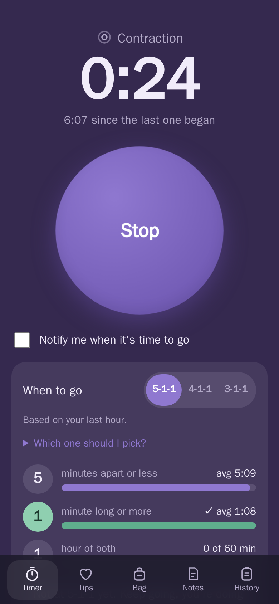
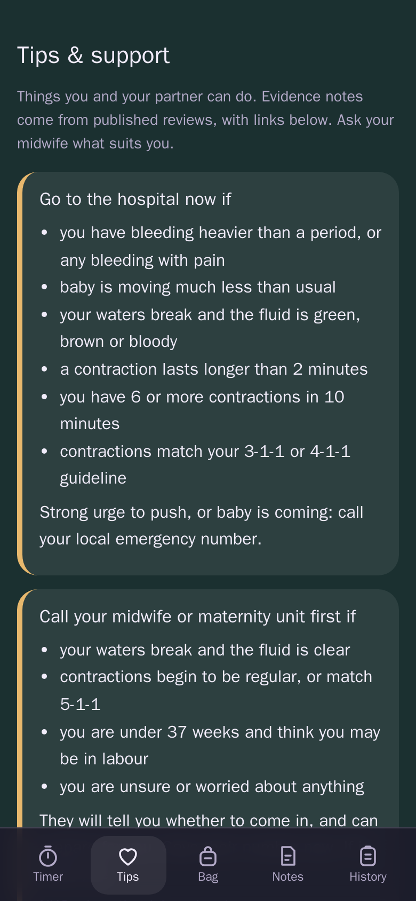
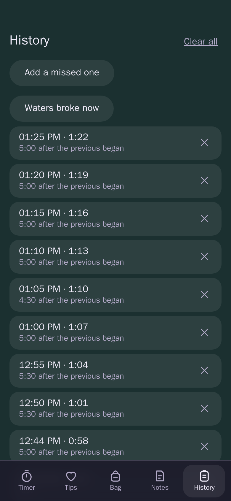
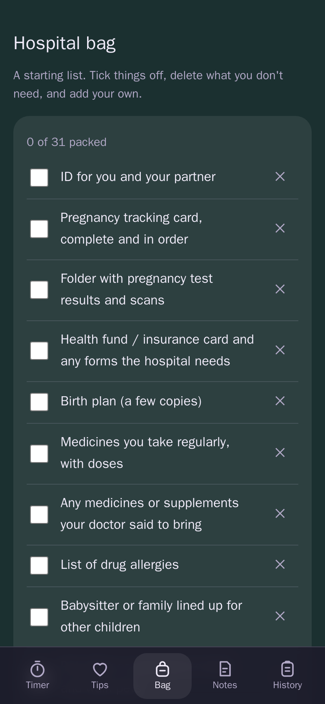

# Contraction Timer

[](https://github.com/Uricorn/Contraction-Timer/actions/workflows/ci.yml)
[](LICENSE)

**Know when it's time to go — without the noise.**
A calm, one-tap contraction timer for labour. No account, no ads, no tracking, no internet needed.
Your data never leaves your phone.

**[Open the web app](https://uricorn.github.io/Contraction-Timer/)** · installs as a PWA · also available as an Android app

<p align="center">
  
  
  
</p>

## Why you'll like it

- **Built for exhausted hands and tired eyes.** One big button starts and stops a contraction. The background colour tells you contracting or resting at a glance.
- **Answers the real question: "is it time?"** A "When to go" panel tracks the 5-1-1 / 4-1-1 / 3-1-1 guideline (your choice) with a progress meter for each digit, and can notify you when you hit it. A "when to call right away" card is always one tap away.
- **Private by design.** Fully offline, no account, no analytics. Nothing is uploaded, ever.
- **Calm, not clinical.** Soft design, light and dark modes, and a button that gently breathes with you during a contraction.
- **Made for your partner too.** Breathing pacer, words to say, and evidence-rated partner tips with links to Cochrane, NHS and NICE.
- **Speaks your language.** English, עברית, العربية, Русский, Español, Українська, Français, Deutsch, Português, 中文, 日本語, 한국어, Italiano, Türkçe and Polski, with right-to-left layout for Hebrew and Arabic. It follows your device language.
- **Tiny and fast.** No UI framework, about 5 kB of JavaScript.

<p align="center">
  
</p>

## Everything it does

- Live timer for the current contraction and the rest since the last one
- One-hour averages: number of contractions, average length, average time apart
- Pause and resume (paused gaps are left out of the averages)
- Hospital bag checklist and hospital notes, both editable
- History with delete, CSV export and "clear all"
- Screen stays awake while a contraction is running; state survives closing the app or restarts
- Works offline (service worker on the web, bundled assets on Android)

> **Not medical advice.** Always follow guidance from your midwife or doctor.

## Get it

| Platform | How                                                                                      |
| -------- | ---------------------------------------------------------------------------------------- |
| Web      | <https://uricorn.github.io/Contraction-Timer/>, then "Add to Home Screen" to install     |
| Android  | Download the APK from [Releases](https://github.com/Uricorn/Contraction-Timer/releases)  |
| F-Droid  | Store metadata is included, see [docs/FDROID.md](docs/FDROID.md)                         |

## Development

Requires Node 22+.

```sh
npm ci
npm run dev        # http://localhost:3000
npm test           # unit tests (Vitest)
npm run lint       # ESLint
npm run build      # type-check + production build into dist/
```

Stack: TypeScript, Vite, Vitest, Capacitor. The timing logic lives in [`src/logic.ts`](src/logic.ts)
and is unit tested; the UI is in [`src/main.ts`](src/main.ts). Translations live in `src/locales/`
(the English text is the key) and `src/i18n.test.ts` fails if a string is missing.

### Android

Requires JDK 21 and the Android SDK.

```sh
npm run android:sync                      # build web app and copy into the Android project
cd android && ./gradlew assembleDebug     # APK in android/app/build/outputs/apk/debug
```

Or open `android/` in Android Studio. The app id is `io.github.uricorn.contractiontimer`.

### CI/CD

| Workflow                                       | When         | What                                                   |
| ---------------------------------------------- | ------------ | ------------------------------------------------------ |
| [`ci.yml`](.github/workflows/ci.yml)           | push / PR    | lint, format check, tests, build, debug APK (artifact) |
| [`pages.yml`](.github/workflows/pages.yml)     | push to main | deploys the web app to GitHub Pages                    |
| [`release.yml`](.github/workflows/release.yml) | tag `v*`     | builds the APK and creates a GitHub release            |

Publishing the web app needs **Settings → Pages → Source: GitHub Actions**. For a signed APK, add the
secrets `ANDROID_KEYSTORE_B64`, `ANDROID_KEYSTORE_PASSWORD` and `ANDROID_KEY_ALIAS`; without them the
release contains an unsigned APK. Dependabot keeps npm, Gradle and Actions up to date.

## Credits

Feature inspiration: [petewritescode/contraction-timer](https://github.com/petewritescode/contraction-timer).

## License

[AGPL-3.0-only](LICENSE)
